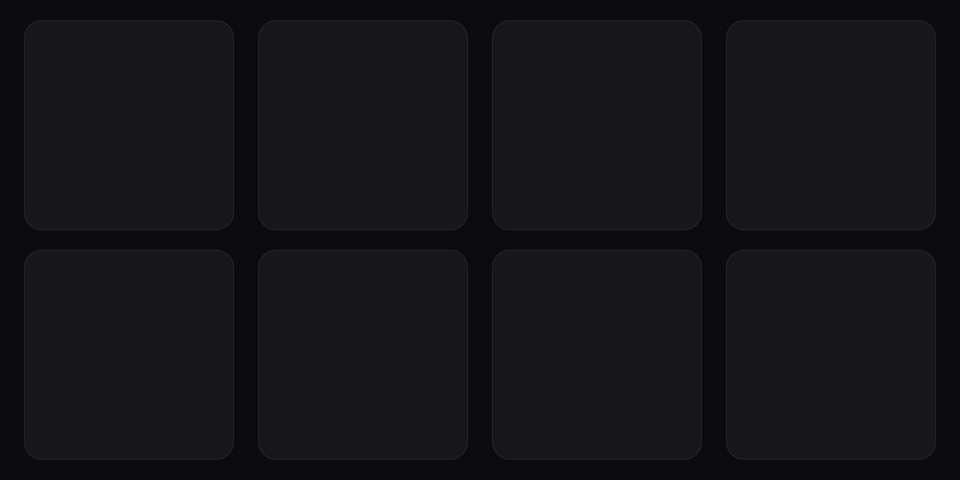

# Compose Uri Painter

Load images from a URL into Jetpack Compose and Compose Multiplatform apps with one function. `rememberUriPainter()` returns a `Painter` you pass to `Image`, with no loader to configure.

[](https://central.sonatype.com/artifact/com.composables/compose-uri-painter)
[](https://github.com/composablehorizons/compose-uri-painter/actions/workflows/ci.yml)
[](LICENSE)

## Features

- **Multiplatform.** Load images with the same API on Android, iOS, desktop, and web (JS and Wasm).
- **Just a Painter.** Works with the `Image` composable and anything else that draws a `Painter`. No custom image component to learn.
- **Animated GIFs.** GIFs play without extra setup.
- **Crossfade.** Fade images in when they finish loading.
- **No setup.** Pre-configured on every platform. Built on [Sketch](https://github.com/panpf/sketch).

## Installation

Add the library to `commonMain`. It is published to Maven Central:

```kotlin
kotlin {
    sourceSets {
        commonMain.dependencies {
            implementation("com.composables:compose-uri-painter:1.4.1")
        }
    }
}
```

## Quick start

Show an image from the network by passing its URL to `rememberUriPainter()` and the result to `Image`:

```kotlin
import androidx.compose.foundation.Image
import androidx.compose.runtime.Composable
import com.composables.uripainter.rememberUriPainter

@Composable
fun Photo() {
    Image(
        painter = rememberUriPainter("https://images.unsplash.com/photo-1476673160081-cf065607f449?q=80&w=1920"),
        contentDescription = "Mountain lake at sunrise",
    )
}
```

The image is transparent while it loads and appears once it is available.

## Examples

### Fade in an image when it loads

Fade the image in instead of showing it at once by passing a duration as `crossfade`:

```kotlin
import kotlin.time.Duration.Companion.milliseconds

Image(
    painter = rememberUriPainter(url, crossfade = 300.milliseconds),
    contentDescription = null,
)
```

Without `crossfade`, the image appears immediately.

### Crop an image to fill its bounds

Fill the available space and crop the overflow by passing `ContentScale.Crop` to both `rememberUriPainter()` and `Image`:

```kotlin
import androidx.compose.foundation.layout.fillMaxSize
import androidx.compose.ui.Modifier
import androidx.compose.ui.layout.ContentScale

Image(
    painter = rememberUriPainter(url, contentScale = ContentScale.Crop),
    contentDescription = null,
    modifier = Modifier.fillMaxSize(),
    contentScale = ContentScale.Crop,
)
```

`rememberUriPainter()` uses `ContentScale.Fit` by default, matching `Image`. Pass the same value to both so the image keeps its proportions while it loads and fades in.

### Show an animated GIF

Play an animated GIF by passing its URL, the same way as any other image:

```kotlin
Image(
    painter = rememberUriPainter("https://example.com/animation.gif"),
    contentDescription = null,
)
```

## Troubleshooting

- **The image stretches or jumps when it appears.** Pass the same `contentScale` to `rememberUriPainter()` and `Image`.
- **Nothing shows on Android.** Your app needs the `android.permission.INTERNET` permission in `AndroidManifest.xml` to load images from the network.
